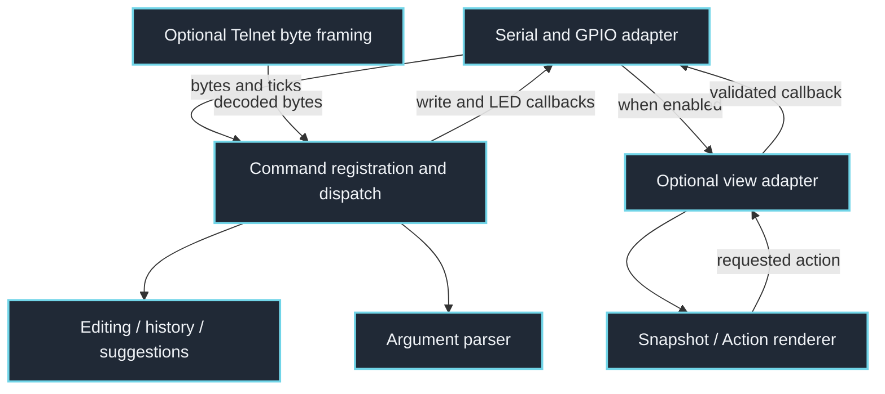
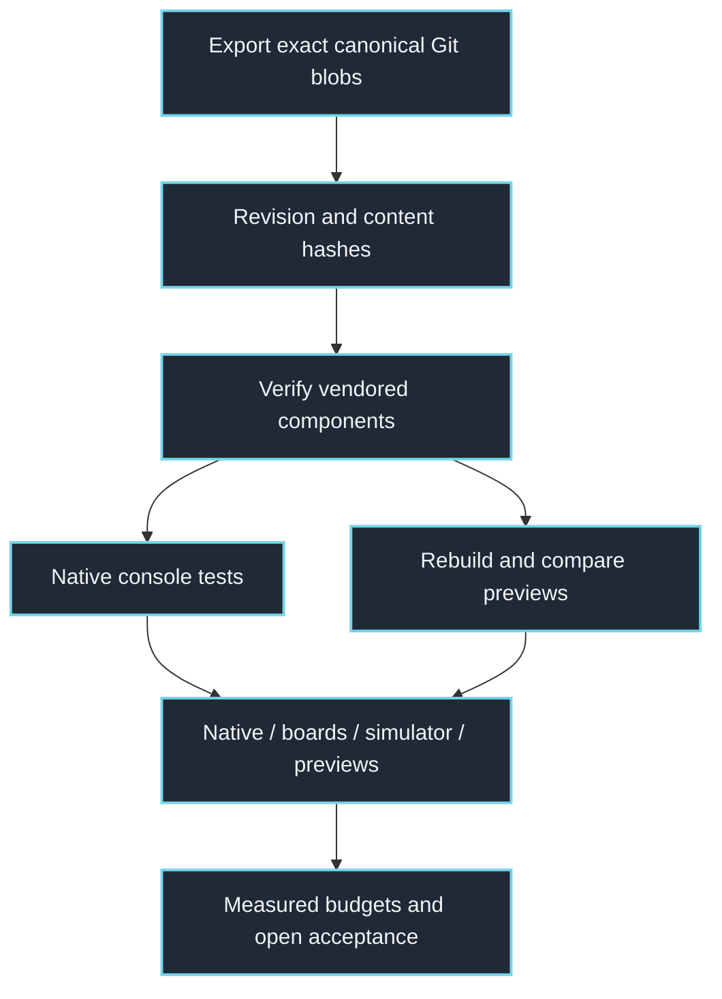

# SerialConsole: clickable architecture

The Arduino sketch is the hardware adapter. Console commands and optional views use exact PortableShell header exports; AVR and STM32 selection does not substitute a second renderer.

Click a component to inspect its implementation. Links are pinned to source commit `85c891cbab7e35b71ff370f7c848ce2557f27e6e`, so this map remains inspectable as the code evolves. Arrows describe source-level relationships, not proof of deployment or physical behavior.

## Serial input to hardware action

The loop supplies time and bounded input. LED access occurs through callbacks in the sketch, not in the shared shell components.

## Exact reuse and evidence

The Telnet helper is not a socket listener: the consumer supplies connection lifetime and authentication. Firmware compilation and simulator checks are separate from physical board acceptance.

## Source index

These links also work in readers that disable clickable diagram nodes.

- [SerialConsole/SerialConsole.ino](https://github.com/DRSDavidSoft/Ardush/blob/85c891cbab7e35b71ff370f7c848ce2557f27e6e/SerialConsole/SerialConsole.ino)
- [SerialConsole/src/portable_console.h](https://github.com/DRSDavidSoft/Ardush/blob/85c891cbab7e35b71ff370f7c848ce2557f27e6e/SerialConsole/src/portable_console.h)
- [SerialConsole/src/portable-shell/portable_editor.h](https://github.com/DRSDavidSoft/Ardush/blob/85c891cbab7e35b71ff370f7c848ce2557f27e6e/SerialConsole/src/portable-shell/portable_editor.h)
- [SerialConsole/src/portable-shell/portable_parse.h](https://github.com/DRSDavidSoft/Ardush/blob/85c891cbab7e35b71ff370f7c848ce2557f27e6e/SerialConsole/src/portable-shell/portable_parse.h)
- [SerialConsole/src/portable_console_view.hpp](https://github.com/DRSDavidSoft/Ardush/blob/85c891cbab7e35b71ff370f7c848ce2557f27e6e/SerialConsole/src/portable_console_view.hpp)
- [SerialConsole/src/portable-shell/portable_device_view.hpp](https://github.com/DRSDavidSoft/Ardush/blob/85c891cbab7e35b71ff370f7c848ce2557f27e6e/SerialConsole/src/portable-shell/portable_device_view.hpp)
- [SerialConsole/src/portable_console_telnet.h](https://github.com/DRSDavidSoft/Ardush/blob/85c891cbab7e35b71ff370f7c848ce2557f27e6e/SerialConsole/src/portable_console_telnet.h)
- [tools/sync-portable-shell.cmake](https://github.com/DRSDavidSoft/Ardush/blob/85c891cbab7e35b71ff370f7c848ce2557f27e6e/tools/sync-portable-shell.cmake)
- [portable-shell.lock](https://github.com/DRSDavidSoft/Ardush/blob/85c891cbab7e35b71ff370f7c848ce2557f27e6e/portable-shell.lock)
- [tools/verify-portable-shell.cmake](https://github.com/DRSDavidSoft/Ardush/blob/85c891cbab7e35b71ff370f7c848ce2557f27e6e/tools/verify-portable-shell.cmake)
- [tests/checks.c](https://github.com/DRSDavidSoft/Ardush/blob/85c891cbab7e35b71ff370f7c848ce2557f27e6e/tests/checks.c)
- [tools/rebuild-previews.cmake](https://github.com/DRSDavidSoft/Ardush/blob/85c891cbab7e35b71ff370f7c848ce2557f27e6e/tools/rebuild-previews.cmake)
- [.github/workflows/build.yml](https://github.com/DRSDavidSoft/Ardush/blob/85c891cbab7e35b71ff370f7c848ce2557f27e6e/.github/workflows/build.yml)
- [VALIDATION.md](https://github.com/DRSDavidSoft/Ardush/blob/85c891cbab7e35b71ff370f7c848ce2557f27e6e/VALIDATION.md)
