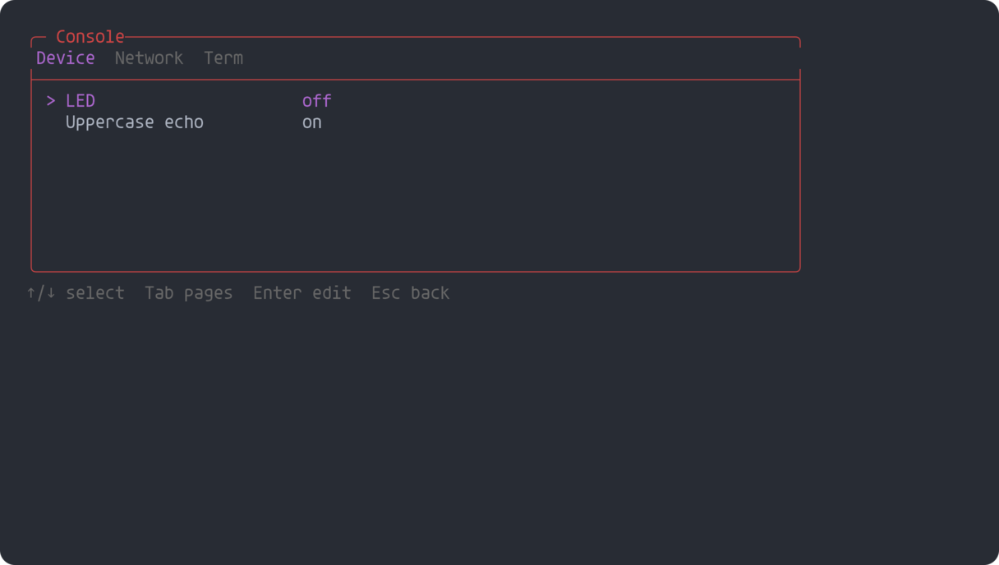

# SerialConsole

The repository keeps its historical name and attribution. Reusable code uses
`portable_console_*`, `PS_CONSOLE_*`, and `SerialConsole/SerialConsole.ino`.
Update old `ardush_*` / `ARDUSH_*` identifiers and includes together; old
product-named aliases are not compiled into this implementation. Git history is retained.

`PS_CONSOLE_PROMPT_LABEL` and `PS_CONSOLE_TITLE` default to `Console`. Prompt storage
is checked at compile time. See the [shared profiles and defaults](https://github.com/atomicdeploy/portable-shell/blob/main/OPTIONS.md).
A byte-driven C99 shell for Arduino AVR and STM32 boards, compatible with PuTTY
and ordinary serial terminals. The optional device view uses freestanding C++11.
No allocation, Arduino calls, OS APIs or external runtime is used in the shell
components. `SerialConsole.ino` alone connects them to the board SDK's serial/GPIO APIs.

Ardush consumes exact, hash-pinned components from
[PortableShell](https://github.com/atomicdeploy/portable-shell), also used by
[PakarController](https://github.com/atomicdeploy/PakarController). Parser,
editor, Telnet and TUI fixes belong upstream, then are repinned here. The original
2018 sketch and MIT attribution remain in Git history; every original command
is retained. See [comparison and validation](VALIDATION.md).



This is a byte-stream replay fixture, not a physical board screenshot. Other
checked frames: [inline draft](previews/edit.png), [transport](previews/transport.png),
[terminal](previews/terminal.png). Red rounded borders, magenta selection, two
columns, contextual footer, tabs and an alternate screen come from the shared
renderer. The Uno profile omits the view to preserve its 2 KB SRAM budget.

## Build and connect

Open `SerialConsole/SerialConsole.ino` in Arduino IDE, or use Arduino CLI. The commands below
compile only. No upload, board reset or live connection occurs automatically.

```text
arduino-cli core install arduino:avr@1.8.8
arduino-cli compile --fqbn arduino:avr:uno SerialConsole
arduino-cli compile --fqbn arduino:avr:mega:cpu=atmega2560 --build-property compiler.cpp.extra_flags=-DPS_CONSOLE_ENABLE_DEVICE_VIEW=1 SerialConsole
arduino-cli core update-index --additional-urls https://raw.githubusercontent.com/stm32duino/BoardManagerFiles/main/package_stmicroelectronics_index.json
arduino-cli core install STMicroelectronics:stm32@3.0.0 --additional-urls https://raw.githubusercontent.com/stm32duino/BoardManagerFiles/main/package_stmicroelectronics_index.json
arduino-cli compile --fqbn STMicroelectronics:stm32:GenF1:pnum=GENERIC_F103C8TX --build-property "compiler.cpp.extra_flags=-DPS_CONSOLE_LED_PIN=PC13 -DPS_CONSOLE_LED_ACTIVE_LOW=1" SerialConsole
```

The default serial transport is `Serial` at **9600 baud**. For the generic
F103C8 profile this is a hardware USART, not USB CDC; use the selected board's
UART mapping and a suitable serial adapter. Select the actual board and polarity
before uploading. Serial availability never blocks setup. The loop accepts at
most 32 queued bytes per iteration; actual transmit backpressure is owned by the
chosen Arduino serial implementation.

| Build setting | Default / purpose |
| --- | --- |
| `PS_CONSOLE_SERIAL`, `PS_CONSOLE_BAUD` | `Serial`, `9600`; choose `Serial1` where supported |
| `PS_CONSOLE_LED_PIN` | `LED_BUILTIN`, or `-1` to disable hardware access |
| `PS_CONSOLE_LED_ACTIVE_LOW` | `0`; set `1` for an active-low LED such as the configured PC13 fixture |
| `PS_CONSOLE_INTERACTIVE` | `1`; `0` selects plain, prompt-free command streams |
| `PS_CONSOLE_ENABLE_DEVICE_VIEW` | `0` on AVR, `1` elsewhere; Mega can explicitly enable it |
| `PS_CONSOLE_ASCII_ONLY` | Define to suppress Unicode in the view; `plain` also disables ANSI/Unicode at runtime |
| `PS_CONSOLE_RAW_ECHO` | `1` preserves exact old echo spacing/quotes; `0` prints parsed arguments |
| `PS_CONSOLE_LEGACY_EXIT_BYTES` | `0`; `1` also emits the original Ctrl-C/Ctrl-Z/NUL sequence on interactive exit |
| `PS_EDITOR_CAPACITY`, `PS_EDITOR_HISTORY` | `64`, `2`; consistent across translation units |
| `PS_EDITOR_PROMPT_BYTES`, `PS_EDITOR_SUGGEST_BYTES` | `12`, `24`; prompt storage includes the terminating NUL |
| `PS_TERMINAL_SOFT_DIV10` | AVR adapter enables shift/subtract; other hosts keep native compiler optimization |

## Commands and reuse

`help` lists the active registry. Original commands: `clear`, `upper`, `noupper`,
`echo`, `led`, `test`, `getcur`, `exit`, `keycodes`. New commands: `status`, `ansi`,
`plain`, `history-clear`, `help`, sketch `version`, and optional `view`.
`led` toggles; `led on`/`led off` set an explicit state. `status` reports observed
LED state or `unknown`, never a fabricated successful hardware action.

Tab completes commands, ↑/↓ recalls history, ←/→ edits, Home/End and Ctrl-A/E
move, Ctrl-U/W erase, Ctrl-C cancels, Ctrl-L clears, and Ctrl-D closes an empty
prompt. Uppercase echo transforms display only. Input editing is ASCII; the
renderer can emit Unicode borders/key symbols. History is bounded and uses the
shared credential-filtering policy. The view stages edits until Enter; Esc
cancels. Only explicit accepted actions reach the GPIO callback.

Custom callbacks are registered in the sketch's immutable `commands[]`. They
can override built-ins and receive up to eight parsed arguments, including argv0.
Decoded argument pointers are valid only during the callback. Store application
state in `port.context`. Callbacks can set `s->status` for batch consumers.

```c
static void greet(portable_console *s, unsigned argc, char *const *argv) {
    if (argc != 2) { s->status = 2; return; }
    portable_console_put(s, argv[1]);
    portable_console_put(s, "\r\n");
}
static const portable_console_command commands[] = {{"greet", greet}};
/* portable_console_init(&state, port, commands, 1, interactive);
   For each byte: portable_console_feed(&state, byte);
   Even without input: portable_console_tick(&state, monotonic_milliseconds); */
```

`getcur` uses a fixed 500 ms total deadline and never reads or waits inside the
shell. `keycodes` is an input mode, not a blocking loop. `exit` closes the session;
reinitialize explicitly when the host accepts a new connection.

`src/portable_console_telnet.h` optionally wraps the same application in the canonical
Telnet negotiator, with NAWS/terminal type, fragmented IAC handling and escaped
output. It uses only byte callbacks. It does **not** open TCP sockets or add
authentication. The transport owner supplies those policies and ordered writes;
serial uses `portable_console_feed` directly. A view owner calls `portable_console_telnet_decode` and
passes DATA bytes to its view's `feed`. Reuse PortableShell/Pakar host adapters
where appropriate; never start a second hardware/session owner.

## Native verification and batch use

```text
cmake -S . -B build -DCMAKE_BUILD_TYPE=Debug
cmake --build build --config Debug
ctest --test-dir build -C Debug --output-on-failure
```

The optional `portable_console_batch` host accepts stdin or **one complete command per
program argument**, e.g. `portable_console_batch "echo hello" "status"`. It has no GPIO:
LED state is `unknown`. The final command determines exit status: 0 success,
2 invalid input, 3 unavailable capability, 127 unknown command. Compiler tools,
test assertions, stdio and SDKs belong to build/test/adapter domains, not core.

To update shared components, use CMake 3.20+ and a clean upstream checkout:

```text
cmake -DPORTABLE_SHELL_SOURCE=/path/to/portable-shell -DPORTABLE_SHELL_REVISION=EXACT_COMMIT -P tools/sync-portable-shell.cmake
cmake -P tools/verify-portable-shell.cmake
```

The six vendored headers and MIT license are byte-identical snapshots recorded
in `portable-shell.lock`. CI checks their hashes. Edit the canonical source and
repin; do not fork fixes inside this directory.
